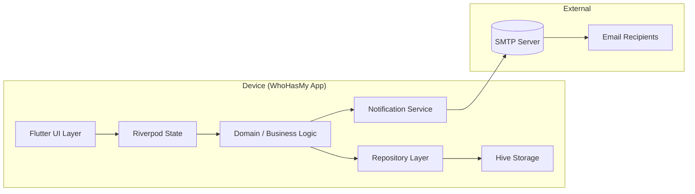

# ARCHITECTURE.md: WhoHasMy

## System Overview

WhoHasMy is a **single-user, offline-first Flutter application** that tracks physical items loaned to contacts. The system has no server, no cloud sync, and no user accounts — all data lives on the device. Email notifications are sent from the app using locally-configured SMTP credentials.



**Key invariant**: No data leaves the device except email content sent via SMTP. There is no backend, no API, no cloud storage.

---

## Architectural Paradigm: Clean Architecture (Ports & Adapters)

WhoHasMy follows **Clean Architecture** with three concentric layers:

| Layer | Responsibility | Depends On |
|---|---|---|
| **Domain** (inner) | Business rules, entities, value objects, use cases | Nothing — pure Dart, no dependencies |
| **Application** (middle) | Use case orchestration, repository interfaces, state management | Domain |
| **Infrastructure** (outer) | Hive storage, email sending, Flutter UI widgets, platform plugins | Application + Domain |

**Dependency rule**: Inner layers never import outer layers. Dependencies point inward only. This ensures business logic is testable in isolation and the app can swap storage or notification implementations without changing domain rules.

### Package Structure
```
lib/
├── core/                    # Shared utilities, constants, extensions
│   ├── constants/           # App-wide constants (risk thresholds, dates)
│   ├── errors/              # Error types and failure classes
│   ├── extensions/          # String, DateTime, int extensions
│   └── utils/               # Formatting helpers, validators
├── domain/                  # INNER LAYER — pure Dart
│   ├── entities/            # Item, Contact, Loan (data classes)
│   ├── repositories/        # Repository interfaces (ports)
│   ├── usecases/            # Business operations
│   └── value_objects/       # RiskLevel, Status, DueDate calculations
├── application/             # MIDDLE LAYER — orchestration
│   ├── providers/           # Riverpod providers (state containers)
│   ├── services/            # Service interfaces (email, date provider)
│   └── validators/          # Form validation logic
├── infrastructure/          # OUTER LAYER — platform concerns
│   ├── storage/             # Hive adapters, box names, serialization
│   ├── email/               # SMTP implementation, email templates
│   └── plugins/             # Platform-specific plugin wrappers
└── presentation/            # Flutter UI (depends on application)
    ├── widgets/             # Reusable UI components
    ├── screens/             # Full-screen views
    ├── navigation/          # Route definitions, bottom nav

## Data Model

### Entities (Domain Layer)

```dart
// lib/domain/entities/item.dart
class Item {
  final String id;              // Hive key: "item:{uuid}"
  final String name;            // Required, non-empty, max 200 chars
  final String? description;    // Optional, max 500 chars
  final Category category;      // Tools, Electronics, Books, Sports, Other
  final List<String> photoKeys; // Hive keys referencing photo blobs
  final ItemStatus status;      // Available, Loaned, In-Maintenance
  final DateTime createdAt;
  final DateTime? updatedAt;

  // Derived: active loan (if any)
  Loan? get activeLoan => /* lookup by status == Loaned */;
}

enum Category { tools, electronics, books, sports, other }
enum ItemStatus { available, loaned, inMaintenance }
```

```dart
// lib/domain/entities/contact.dart
class Contact {
  final String id;              // Hive key: "contact:{uuid}"
  final String name;            // Required, non-empty, max 100 chars
  final String? email;          // Optional but required for loan notifications
  final String? phone;          // Stored for future SMS (v2+), no v1 notifications
  final DateTime createdAt;
  final DateTime? updatedAt;

  // Derived: active loans count
  int get activeLoanCount => /* count loans where contactId == this.id && !returned */;
}
```

```dart
// lib/domain/entities/loan.dart
class Loan {
  final String id;              // Hive key: "loan:{uuid}"
  final String itemId;          // Reference to Item.id (Hive key string)
  final String contactId;       // Reference to Contact.id (Hive key string)
  final DateTime dueDate;       // Required, >= today
  final DateTime createdAt;
  final bool isReturned;        // False = active, True = returned
  final DateTime? returnedAt;
  final String? returnConditionNotes;

  // Derived: risk level (computed from days overdue)
  RiskLevel get risk => RiskLevel.calculate(daysOverdue);
  int get daysOverdue => isReturned ? 0 : DateTime.now().difference(dueDate).inDays;
}
```

### Value Objects — Risk Calculation

```dart
// lib/domain/value_objects/risk_level.dart
enum RiskLevel { none, low, medium, high }

class RiskCalculator {
  static RiskLevel calculate(int daysOverdue) {
    if (daysOverdue < 2) return RiskLevel.none;       // Not overdue (future or today/yesterday)
    if (daysOverdue <= 4) return RiskLevel.low;       // 2-4 days overdue
    if (daysOverdue == 5) return RiskLevel.medium;    // Exactly 5 days overdue
    return RiskLevel.high;                             // >5 days overdue
  }
}

// Aligns with PRD FR-17 risk thresholds. Ranges are explicit:
//   None: < 2 days overdue (including future due dates)
//   Low: 2-4 days overdue
//   Medium: exactly 5 days overdue
//   High: >5 days overdue
```

### Storage Keys (Hive Boxes)

| Box Name | Entity Type | Key Pattern | Example |
|---|---|---|---|
| `items` | Item | `"item:{uuid}"` | `"item:a1b2c3d4"` |
| `contacts` | Contact | `"contact:{uuid}"` | `"contact:e5f6g7h8"` |
| `loans` | Loan | `"loan:{uuid}"` | `"loan:i9j0k1l2"` |
| `photos` | Image blob | `"photo:{uuid}"` | `"photo:m3n4o5p6"` |
| `settings` | AppSettings | `"app_settings"` (single key) | `"app_settings"` |


## State Management: Riverpod + Freezed

### Provider Hierarchy
```
┌─────────────────────────────────────────────┐
│  AsyncNotifierProvider (autoDispose)        │
│  └── DashboardStateProvider                 │
│      ├── items: List<ItemCardData>          │
│      ├── loading: bool                      │
│      ├── error: String?                     │
│      └── refresh() → reload from Hive       │
├─────────────────────────────────────────────┤
│  AsyncNotifierProvider (autoDispose)        │
│  └── ItemsCatalogStateProvider              │
│      ├── items: List<Item>                  │
│      ├── filter: ItemStatus?                │
│      └── refresh() → reload from Hive       │
├─────────────────────────────────────────────┤
│  AsyncNotifierProvider (autoDispose)        │
│  └── ContactsStateProvider                  │
│      ├── contacts: List<Contact>            │
│      └── searchQuery: String                │
├─────────────────────────────────────────────┤
│  Provider (not async, form state only)      │
│  └── RegistrationFormStateProvider          │
│      ├── step: int (0, 1, 2)               │
│      ├── formData: Map<String, dynamic>     │
│      ├── errors: Map<String, String>        │
│      └── nextStep() / submit()              │
├─────────────────────────────────────────────┤
│  Provider (singleton, app-wide settings)    │
│  └── SettingsProvider                       │
│      ├── ownerEmail: String?                │
│      ├── smtpConfig: SmtpConfig?            │
│      ├── notificationInterval: int          │
│      └── save() → write to Hive             │
└─────────────────────────────────────────────┘
```

### State Classes (Freezed)
```dart
@freezed
class DashboardState with _$DashboardState {
  const factory DashboardState({
    required List<ItemCardData> loans,
    required bool loading,
    String? error,
  }) = _DashboardState;

  factory DashboardState.initial() => const DashboardState(
    loans: [],
    loading: false,
  );
}

@freezed
class ItemCardData with _$ItemCardData {
  const factory ItemCardData({
    required String itemId,
    required String itemName,
    required String borrowerName,
    required DateTime dueDate,
    required RiskLevel risk,
    required int daysOverdue,
    required List<String>? photoKeys,
  }) = _ItemCardData;
}
```

### State Update Flow
```
User Action (tap/swipe)
    │
    ▼
Presentation Widget → Riverpod ConsumerWidget
    │
    ▼
AsyncNotifier.update() → calls UseCase
    │

## Storage Layer: Hive

### Why Hive
- **Zero-config**: No database initialization, no migrations
- **Fast reads**: In-memory cache after first load; dashboard loads in <200ms for 100 items
- **Small footprint**: ~50KB overhead vs SQLite's ~2MB
- **Flutter-native**: Pure Dart implementation, no platform channels needed
- **Blob support**: Native support for storing image bytes as values

### Hive Setup (One-Time Initialization)
```dart
Future<void> initHive() async {
  Hive.initFlutter();
  Hive.registerAdapter(ItemAdapter());
  Hive.registerAdapter(ContactAdapter());
  Hive.registerAdapter(LoanAdapter());
  Hive.registerAdapter(CategoryAdapter());
  Hive.registerAdapter(ItemStatusAdapter());
  Hive.registerAdapter(RiskLevelAdapter());
  await Hive.openBox<Item>('items');
  await Hive.openBox<Contact>('contacts');
  await Hive.openBox<Loan>('loans');
  await Hive.openBox<dynamic>('photos');
  await Hive.openBox<AppSettings>('settings');
}
```

### Repository Interfaces (Ports)
```dart
abstract class ItemRepository {
  Future<List<Item>> getAll();
  Future<Item?> getById(String id);
  Future<void> insert(Item item);
  Future<void> update(Item item);
  Future<void> delete(String id);
  Stream<List<Item>> watchAll();
}

abstract class LoanRepository {
  Future<List<Loan>> getAllActive();
  Future<List<Loan>> getOverdue();
  Future<void> insert(Loan loan);
  Future<void> markReturned(String loanId, {String? conditionNotes});
  Stream<List<Loan>> watchActive();
}

abstract class ContactRepository {
  Future<List<Contact>> getAll();
  Future<Contact?> getById(String id);
  Future<void> insert(Contact contact);
  Future<void> update(Contact contact);
  Future<void> delete(String id);
  Stream<List<Contact>> watchAll();
}
```

### Repository Implementation Example
```dart
class ItemRepositoryImpl implements ItemRepository {
  final Box<Item> _box;
  ItemRepositoryImpl(this._box);

  @override Future<List<Item>> getAll() => Future.value(_box.values.toList());
  @override Future<Item?> getById(String id) => Future.value(_box.get(id)?.value);
  @override Future<void> insert(Item item) async => await _box.put(item.id, item);
  @override Future<void> update(Item item) async => await _box.put(item.id, item);
  @override Future<void> delete(String id) async => await _box.delete(id);
  @override Stream<List<Item>> watchAll() => _box.watch().map(
    (e) => e.value.values.toList(),

## Notification Subsystem Design

### Architecture Overview
This is the system's most complex and risky component. Email sending is isolated behind a service interface so it can be swapped or mocked without affecting domain logic.

```mermaid
graph TD
    SCHED[Scheduler: workmanager / flutter_local_notifications] -->|daily check| NM[NotificationService interface]
    NM --> LOAN[LoanRepository.getOverdue()]
    LOAN --> RISK[RiskCalculator.calculate()]
    RISK --> SMTP[SmtpEmailSender implementation]
    SMTP --> CONF[SettingsProvider: ownerEmail + smtpConfig]
    SMTP --> EMAIL[(SMTP Server)]

    SUBMIT[RegistrationForm.submit()] --> NM|send initial loan email|
```

### Service Interface (Application Layer)
```dart
abstract class NotificationService {
  Future<void> sendLoanNotification(Loan loan, Contact borrower);
  Future<void> sendOverdueReminders();
  Future<void> scheduleDailyChecks();
  Future<void> cancelScheduledChecks();
}
```

### SMTP Implementation (Infrastructure Layer)
```dart
class SmtpEmailSender implements EmailSender {
  final SmtpConfig config;    // Host, port, username, password, TLS settings
  final String ownerEmail;    // From address

  Future<void> send({
    required String to,
    required String subject,
    required String body,
    bool isHtml = true,
  }) async {
    // Use flutter_email_sender plugin for cross-platform SMTP
    // Subject prefixes per FR-14:
    //   Low (2-4 days): "Reminder:" prefix
    //   Medium (5 days): "Overdue:" prefix
    //   High (>5 days): "Urgent:" prefix
  }
}

class SmtpConfig {
  final String host;     // e.g., "smtp.gmail.com"
  final int port;        // 465 (SSL) or 587 (TLS)
  final String username; // Email address
  final String password; // App-specific password
  final bool useSsl;     // true for port 465, false for 587
}
```

### Email Templates
```dart
/// Initial loan notification — sent when a new loan is created.
String loanCreatedTemplate({
  required String itemName,
  required String borrowerName,
  required DateTime dueDate,
}) => '''
Dear $borrowerName,

$ownerName has loaned you the following item:

  Item: $itemName
  Due date: ${dueDate.toLocal().toString().split(' ')[0]}

Please return it by the due date. Thank you!

— Sent from WhoHasMy
''';

/// Overdue reminder — subject and body vary by risk level.
String overdueReminderTemplate({
  required String prefix,    // "Reminder:", "Overdue:", or "Urgent:"
  required String itemName,
  required int daysOverdue,
}) => '''
$prefix The following item is overdue:

  Item: $itemName
  Days overdue: $daysOverdue

Please return it as soon as possible.

— Sent from WhoHasMy
''';
```

### Scheduler — Platform Matrix
| Platform | Mechanism | Reliability | Notes |
|---|---|---|---|
| **Android** | `workmanager` plugin | High | Background task runs daily at configured time |
| **iOS** | `flutter_local_notifications` periodic trigger | Best-effort | Limited background execution; in-app banner fallback on next launch |
| **macOS** | `flutter_local_notifications` | Good | Similar to iOS but less restrictive |

## Platform-Specific Considerations

### Flutter Target Matrix
| Platform | Build Target | Key Consideration |
|---|---|---|
| **Android** | `minSdk 21` | Full background task support via workmanager; camera/storage permissions |
| **iOS** | `deployment target 13.0` | Background execution limited; photo library permission; SMTP via plugin |
| **macOS** | `deployment target 10.14` | Similar to iOS constraints; native file picker for photos |
| **Chrome Webapp** | Standard web build | No background tasks; email must use web-compatible SMTP; no camera (gallery only); service worker for offline caching |

### Platform Channels Required
| Purpose | Plugin | Cross-Platform? |
|---|---|---|
| Email sending | `flutter_email_sender` or `email` plugin | Yes (Android, iOS, macOS); limited on web |
| Photo capture/gallery | `image_picker` | Yes (all platforms) |
| Background scheduling | `workmanager` (Android), `flutter_local_notifications` (iOS/macOS) | Partial — web needs different approach |
| Local storage | Hive (pure Dart) | **Yes** — no platform channels needed |

### Webapp Limitations (Chrome)
1. **No background email sending**: Service workers can send emails via SMTP but require user interaction or a backend relay. Mitigation: queue emails in Hive and send when user opens the app on a device with email capability.
2. **No camera access**: Use gallery picker only (`ImagePicker.pickImage(source: ImageSource.gallery)`).
3. **Storage limits**: Hive stores data in IndexedDB on web; ~50MB quota per origin. Sufficient for 100 items with photos.
4. **Offline support**: Service worker caches Flutter assets; Hive data persists in IndexedDB across sessions.

---
| **Chrome Webapp** | Service Worker + polling | Low (tab must be open) | No true background tasks; emails queue in Hive and send when user opens app on a device with email capability |

**[ASSUMPTION: iOS background notification scheduling is limited.** In practice, iOS may not run the daily check if the app is in the background. Mitigation: show an in-app banner on next launch reminding the user of overdue items. The scheduler handles Android and desktop reliably; iOS gets best-effort with fallback UI reminders.]


## Key Technical Decisions (AD)

### AD-1: Architectural Paradigm — Clean Architecture (Ports & Adapters)
**Binds**: Domain layer is pure Dart with zero external dependencies. Repository interfaces live in domain; implementations live in infrastructure. All dependencies point inward.
**Prevents**: Business logic from being coupled to Flutter, Hive, or email plugins. Enables unit testing of use cases without mocking storage or UI.
**Rule**: No outer-layer import in inner layers. Enforced by linter rules (`import_sorter` + custom lint).

### AD-2: State Management — Riverpod 2.x + Freezed
**Binds**: All app state uses `AsyncNotifierProvider` (async data) or `NotifierProvider` (form state). State classes use `@freezed` for immutability. Providers are `autoDispose` to prevent memory leaks.
**Prevents**: Manual lifecycle management, stale state, and unbounded memory growth from retained providers.
**Rule**: Every provider must have a corresponding test in the domain/application layer. UI tests use `ProviderContainer` with mocked repositories.

### AD-3: Local Storage — Hive (NoSQL key-value)
**Binds**: Five Hive boxes (`items`, `contacts`, `loans`, `photos`, `settings`). All entities serialized via generated adapters. Keys follow `"type:{uuid}"` pattern.
**Prevents**: Schema migration complexity, SQLite overhead, and platform-specific database drivers.
**Rule**: No raw SQL or query builders. All data access goes through repository interfaces. Photo blobs stored as `List<int>` (bytes) in the `photos` box.

### AD-4: Email Delivery — User-Configured SMTP
**Binds**: Owner configures SMTP settings once in Settings screen. App stores credentials encrypted (using `flutter_secure_storage` on mobile platforms). Email sending uses `flutter_email_sender` plugin for cross-platform compatibility.
**Prevents**: Dependency on external email services, API keys managed by third parties, or cloud relay servers that would violate the local-only design principle.
**Rule**: SMTP credentials are never transmitted outside the device except to the configured SMTP server during email send. No telemetry, no analytics, no crash reporting that includes email content.

### AD-5: Risk Calculation — Pure Function in Domain Layer
**Binds**: `RiskCalculator.calculate(int daysOverdue)` is a pure function with no side effects. Returns one of four enum values based on explicit thresholds defined in FR-17.
**Prevents**: Risk logic from being scattered across UI, repository, or notification code. Ensures consistent risk calculation everywhere.
**Rule**: All risk level references must call `RiskCalculator.calculate()`. No hardcoded threshold comparisons anywhere else in the codebase.

### AD-6: Photo Storage — Hive Blob with Compression
**Binds**: Photos are compressed to JPEG at 70% quality before storage as byte arrays in Hive's `photos` box. Maximum 3 photos per item. Original resolution is not preserved.
**Prevents**: Storage bloat from full-resolution images. Keeps total app size under 50MB even with 100 items x 3 photos each at 2MP average.
**Rule**: Compression happens in the use case layer (before repository call), not in the UI layer. This ensures consistency whether photos are added via camera or gallery picker.

### AD-7: Scheduler — Platform-Specific Implementation Behind Single Interface
**Binds**: `NotificationService.scheduleDailyChecks()` delegates to platform-specific schedulers. Android uses `workmanager`; iOS/macOS use `flutter_local_notifications` with periodic triggers; web uses service worker polling.
**Prevents**: Platform-specific scheduling logic from leaking into domain or application layers.
**Rule**: The scheduler interface is defined in the application layer. Implementations live in `infrastructure/email/scheduler/`. Each platform has its own file.

---

## Deferred Decisions (Not Needed for v1)

| Decision | Reason to Defer | Revisit Condition |
|---|---|---|
| Data export / backup format | Out of scope per PRD x7; single-device assumption holds for v1 | If user requests multi-device support or data loss concerns arise |
| Barcode/QR scanning for item registration | Explicitly out of scope per PRD x7 | If user reports manual entry is too slow for bulk registration |
| SMS notifications | Deferred to v2+ per FR-15 in PRD | When SMS integration is prioritized over other features |
| Dark mode toggle (user preference) | System dark mode is sufficient; no user-facing theme switch needed | If user requests custom color themes or light-only mode |
| Multi-language support (i18n) | English-only for v1; single-user tool | If app is shared with non-English speakers |

---

## Open Questions

| # | Question | Impact | Suggested Resolution |
|---|---|---|---|
| OQ-1 | How should the app handle a contact being deleted while they have active loans? | Data integrity, dashboard consistency | Preserve loan record but show borrower name as "[deleted]" — per validation report recommendation. Add consequence to ContactRepository.delete(). |
| OQ-2 | What happens when the owner's email address changes in Settings? | Notification delivery continuity | Existing loans keep their original notification state; new reminders use updated email. No re-sending of past notifications. |
| OQ-3 | Should overdue notification intervals be configurable per risk level? | FR-13/14 say "configurable" but doesn't specify granularity | Default: daily for all overdue levels. Configurable as a single interval in Settings. Per-risk-level configuration deferred to v2+. |

---

*This architecture spine defines the invariants for WhoHasMy's system design. All downstream development (UI implementation, storage operations, notification logic) must conform to these decisions. Deferred and open items are explicitly marked and do not block initial implementation.*